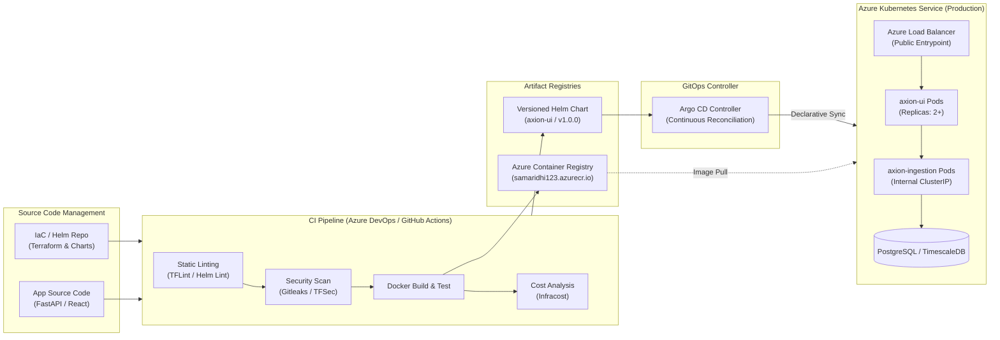

<p align="center">
  
</p>

<h1 align="center">Samarendra Kumar</h1>
<h3 align="center">Senior Azure DevOps Engineer | Cloud Platform &amp; GitOps Specialist</h3>

<p align="center">
  
</p>

<p align="center">
  <a href="https://github.com/samarendra12"></a>
  
  
  
  
  
  
  
</p>

---

## 👨‍💻 Professional Summary

Senior Azure DevOps Engineer and Cloud Platform Specialist specializing in **Enterprise Azure Infrastructure**, **Infrastructure as Code (Terraform)**, **Kubernetes (AKS)**, **Helm Chart Engineering**, **GitOps with Argo CD**, and **Automated DevSecOps CI/CD Pipelines**.

- **Cloud Platform Architecture**: Proven hands-on track record designing and automating Microsoft Azure Enterprise-Scale Landing Zones, hub-and-spoke virtual networks, private endpoints, network security groups, and identity governance.
- **Infrastructure as Code**: Author of modular, reusable Terraform architectures leveraging remote state locking in Azure Blob Storage, strict variable validation, and automated static security analysis.
- **Kubernetes, Helm & GitOps**: Extensive experience packaging distributed microservices into production Helm charts, configuring resource limits, probes, ingress controllers, and establishing automated reconciliation loops via Argo CD.
- **Shift-Left DevSecOps**: Builder of enterprise CI/CD pipelines integrating automated secret scanning (Gitleaks), code linting (TFLint), vulnerability detection (TFSec), and infrastructure cost estimation (Infracost) before production deployment.

---

## 🛠️ Technology Stack & Competencies

| Domain | Core Technologies & Capabilities |
| :--- | :--- |
| **Cloud Platforms** | **Microsoft Azure**, Azure Kubernetes Service (AKS), Azure Container Registry (ACR), Azure Key Vault, Azure Storage, Azure Monitor, Log Analytics, Azure Virtual Networks, NSGs, Private Endpoints, Load Balancers |
| **Infrastructure as Code** | **Terraform** (0.14+ to 1.x), AzureRM Provider v4.x, Reusable Module Design, Remote State Management (Azure Blob Backend with Lease Locking), Dynamic Blocks, State Migration |
| **Containers & Orchestration** | **Docker**, Multi-stage Dockerfiles, Container Hardening, **Kubernetes**, Azure Kubernetes Service (AKS), Namespaces, Deployments, Services, ConfigMaps, Secrets, Ingress, Pod Health Probes, Resource Quotas |
| **Packaging & GitOps** | **Helm 3**, Custom Chart Architecture, `values.yaml` Hierarchy, Helm Linting & Dry-run, **Argo CD**, Git-as-Single-Source-of-Truth, Automated Sync Policies, Drift Detection, Rollback Management |
| **CI / CD Automation** | **Azure DevOps Pipelines** (Multi-Stage YAML), Custom Self-Hosted Agent Pools, **GitHub Actions**, Automated Build, Test, Security Gating, Artifact Publishing, Release Approvals |
| **DevSecOps & Quality** | **Gitleaks** (Secret Detection), **TFLint** (Static IaC Linting), **TFSec** (Misconfiguration Scanning), **Infracost** (Pre-merge Cloud Cost Estimation), Least-Privilege RBAC |
| **Networking & Systems** | TCP/IP, DNS, Subnetting, CIDR, Nginx Reverse Proxy, SSL/TLS Termination, Linux Administration (Ubuntu), Windows Server |
| **Scripting & Languages** | **PowerShell**, **Bash / Shell**, **Python**, YAML, JSON, HCL |

---

## 🚀 Featured Engineering Projects

### 1. [Axion Telemetry Cloud Platform (AKS, Helm & GitOps)](https://github.com/samarendra12/axion-helm)
> **Modern distributed telemetry ingestion platform containerized, packaged with Helm 3, and reconciled onto Azure Kubernetes Service via GitOps / Argo CD.**

* **Problem Solved:** Managing independent microservice deployments (UI frontend, Python ingestion API, and database services) with hardcoded Kubernetes manifests caused configuration drift, inconsistent scaling across environments, and high operational overhead.
* **Architecture & Implementation:**
  * Containerized the ingestion engine (FastAPI / TimescaleDB) and web dashboard into lightweight Docker images published to Azure Container Registry (ACR).
  * Engineered a production-grade **Helm 3 Chart** with modular templates (`deployment.yaml`, `service.yaml`, `telemetry.yaml`) parameterized via a structured `values.yaml` supporting dynamic replicas, image tagging, and Azure Load Balancer bindings.
  * Implemented an **Argo CD GitOps application** that tracks the version-controlled Git repository as the single source of truth, automating synchronization to the AKS cluster with zero-downtime rolling updates.
  * Built an automated **Azure DevOps pipeline** executing Helm linting, template rendering validation, and automated upgrades against AKS namespaces.
* **Key Features:** Liveness/readiness probes, strict CPU/memory resource limits, service port abstraction, automated rollback via `helm rollback`, and Git-driven drift remediation.

```
[Developer Commit] ──► [GitHub / Azure Repos]
                              │
                    ┌─────────┴─────────┐
                    ▼                   ▼
           [Docker Build & Push]   [Helm Chart Package]
                    │                   │
                    ▼                   ▼
           [Azure Container Reg]   [GitOps Manifest Repo]
                    │                   │
                    │         ┌─────────┘
                    ▼         ▼
             [Argo CD GitOps Controller]
                          │
                          ▼ (Automated Sync)
             [Azure Kubernetes Service (AKS)]
             ├── axion-ui (LoadBalancer IP)
             └── axion-ingestion (ClusterIP / Internal)
```

---

### 2. [Automated Azure DevSecOps Pipeline](https://github.com/samarendra12/axion)
> **Multi-stage Azure DevOps pipeline incorporating shift-left security gates (Gitleaks, TFLint, TFSec, Infracost) and automated Terraform provisioning.**

* **Problem Solved:** Cloud infrastructure teams often push Terraform code without prior static analysis, risking secret exposure, misconfigured firewall rules, and unexpected Azure billing spikes.
* **Architecture & Implementation:**
  * Constructed a 6-stage Azure DevOps YAML pipeline running on custom self-hosted build agent pools.
  * **Stage 1 (Gitleaks):** Scans the entire Git commit history for API keys, personal access tokens, and passwords, failing the build immediately upon secret detection.
  * **Stage 2 (TFLint):** Enforces Terraform best practices, naming standards, and deprecated syntax rules across all `.tf` files.
  * **Stage 3 (TFSec):** Analyzes Terraform HCL for security vulnerabilities (e.g., exposed ports, unencrypted storage, missing network controls).
  * **Stage 4 (Infracost):** Calculates cloud cost differentials against Azure pricing APIs and generates a detailed cost breakdown before merge.
  * **Stages 5 & 6 (Terraform Execution):** Executes `init`, `validate`, `plan`, and manual approval-gated `apply` utilizing an Azure Storage Blob backend with state locking.
* **Security & Reliability:** Eliminates hardcoded credentials through service connections and parameterized variables (`ARM_SUBSCRIPTION_ID`).

---

### 3. [Enterprise Azure Landing Zone & Modular Terraform Library](https://github.com/samarendra12/Samaridhi)
> **Cloud Adoption Framework (CAF) aligned modular Terraform framework provisioning isolated Azure landing zone foundations.**

* **Problem Solved:** Monolithic Terraform scripts lead to slow plan executions, high blast radiuses, and duplicate configuration when spinning up multi-tier environments.
* **Architecture & Implementation:**
  * Developed a suite of decoupled, reusable Terraform modules:
    * `azurerm_resource_group`: Standardized regional tagging and lifecycle management.
    * `azurerm_virtual_network` & `azurerm_subnet`: Tiered network isolation (DMZ, Application, Database subnets).
    * `nic` & `public_ip`: Dynamic IP allocation with diagnostic settings.
    * `azurerm_virtual_machine`: Standardized Linux/Windows server templates with SSH key injection.
    * `azurerm_sql_server` & `azurerm_sequal_database`: Azure SQL database provisioning with firewall rules and TLS 1.2 enforcement.
  * Configured state management with remote Azure Storage Blob containers, state lease locking, and isolated workspace state separation.
* **Key Features:** DRY code structure, strict variable type constraints, modular inputs/outputs, and comprehensive parameterization.

---

### 4. [Multi-Tier Secure Application Deployment (Nginx Reverse Proxy & Private Backend)](https://github.com/samarendra12/todo_backend)
> **Secure full-stack application topology deploying isolated application services inside private virtual networks fronted by Nginx.**

* **Problem Solved:** Exposing application runtime ports (e.g., port 8000/3000) directly to the public internet creates severe security vulnerabilities and prevents centralized SSL/header governance.
* **Architecture & Implementation:**
  * Provisioned a multi-subnet network architecture separating public-facing web proxies from backend compute.
  * Configured Nginx as a reverse proxy routing incoming traffic (`/api`) to private internal IPs over Azure's software-defined network.
  * Automated build, artifact packaging, and web server deployment using Azure DevOps release pipelines.
* **Key Features:** Header forwarding (`X-Real-IP`, `X-Forwarded-For`), port isolation, and zero public exposure of backend application ports.

---

## 🔄 End-to-End GitOps & Cloud Delivery Architecture



---

## 💡 Engineering & Platform Philosophy

* **Declarative GitOps Over Manual Operations**: Every infrastructure element and Kubernetes workload must exist as auditable code in Git. If it isn't in Git, it doesn't exist in production.
* **Shift-Left Security as Quality Gates**: Security is not an afterthought; automated secret detection and static misconfiguration scans run before any infrastructure code touches a plan or apply stage.
* **Modular, Reusable Infrastructure**: Monolithic templates create blast-radius liabilities. Infrastructure components must be decoupled, version-controlled, and tested independently.
* **Observable, Resilient Systems**: Microservices must expose health telemetry, readiness/liveness probes, and CPU/memory constraints to guarantee cluster stability and self-healing.
* **Evidence-Based Troubleshooting**: Root-cause analysis driven by logs, metrics, container exit codes, and network traces rather than guesswork.

---

## 📬 Professional Contact & Connect

* **Location:** India (Open to Remote & Hybrid Global Opportunities)
* **GitHub Profile:** [github.com/samarendra12](https://github.com/samarendra12)
* **Positioning:** Senior Azure DevOps Engineer | Cloud Platform Engineer | Kubernetes & GitOps Architect
* **Primary Domains:** Azure Cloud Architecture, Terraform Enterprise, AKS, Helm, Argo CD, DevSecOps CI/CD Automation

---
<p align="center">
  <sub>Designed &amp; Architected with clean engineering rigor • Maintained by <a href="https://github.com/samarendra12">Samarendra Kumar</a></sub>
</p>
