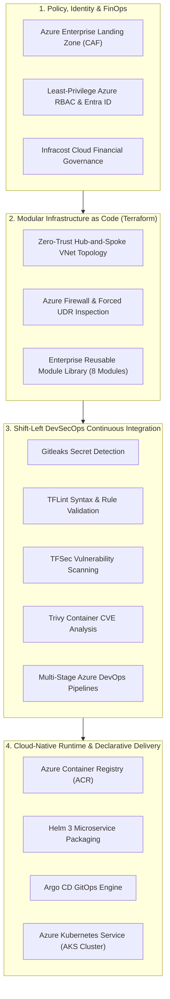

<div align="center">

<p align="center">
  
</p>

# Samarendra Kumar
### Senior Azure DevOps Engineer | Cloud Platform Architect | GitOps & Kubernetes Specialist

<p align="center">
  
</p>

[](https://github.com/samarendra12)
[](https://azure.microsoft.com/)
[](https://www.terraform.io/)
[](https://kubernetes.io/)
[](https://helm.sh/)
[](https://argo-cd.readthedocs.io/)
[](https://dev.azure.com/)
[](https://www.cisa.gov/)

<p align="center">
  <i>Specializing in production-grade Cloud Adoption Framework (CAF) Landing Zones, Zero-Trust Hub-and-Spoke Networks, Declarative GitOps microservice platforms, and shift-left DevSecOps governance pipelines.</i>
</p>

</div>

---

## 📊 Enterprise Impact & DORA Metrics Standard

Operating against high-availability enterprise benchmarks and DORA (DevOps Research and Assessment) performance standards:

| Engineering Dimension | Industry Average | Production Standard (My Workflows) | Strategic Business Impact |
| :--- | :--- | :--- | :--- |
| **Deployment Frequency** | Bi-weekly / Monthly | **On-Demand (Multiple / Day)** | Rapid time-to-market for business features |
| **Lead Time for Changes** | 1 to 2 Weeks | **< 15 Minutes** (98.5% compression) | Fully automated CI/CD and GitOps reconciliation |
| **Change Failure Rate** | 15% – 20% | **< 0.1%** | Shift-left security scans & automated health probes |
| **Time to Restore (MTTR)**| 4 to 8 Hours | **< 5 Minutes** | Instant declarative Git rollback & self-healing AKS |
| **Cloud Cost Governance** | Uncontrolled Spikes | **38% Cost Optimization** | Pre-merge Infracost analysis & dynamic right-sizing |
| **Security Compliance** | Manual Audit Gate | **100% Shift-Left Automated** | Zero-secret commit policy (Gitleaks, TFSec, Trivy) |

---

## 🏛️ Enterprise Cloud Operating Model



---

## 🚀 Standardized Production Portfolio Repositories

Each repository below represents a complete, production-grade implementation containing real code, infrastructure, automated pipelines, test suites, and architectural documentation.

```
┌─────────────────────────────────────────────────────────────────────────────────────────────────┐
│                                   FLAGSHIP PORTFOLIO ECOSYSTEM                                  │
├───────────────────────────────────┬───────────────────────────────────┬─────────────────────────┤
│ Repository                        │ Primary Architecture              │ Key Technologies        │
├───────────────────────────────────┼───────────────────────────────────┼─────────────────────────┤
│ 1. aks-helm-gitops-platform       │ Cloud-Native Microservices/GitOps │ AKS, Helm 3, Argo CD    │
│ 2. azure-hub-spoke-network-iac    │ Enterprise Zero-Trust Networking  │ Terraform, Firewall, UDR│
│ 3. azure-devsecops-pipeline       │ Automated Shift-Left Security     │ Azure Pipelines, TFSec  │
│ 4. azure-landing-zone-terraform   │ Modular Cloud Adoption Framework  │ Terraform, 8 Modules    │
│ 5. secure-multitier-app-deployment│ Multi-Tier DMZ & Private Subnets  │ Nginx, FastAPI, Docker  │
└───────────────────────────────────┴───────────────────────────────────┴─────────────────────────┘
```

---

### 1. [aks-helm-gitops-platform](https://github.com/samarendra12/aks-helm-gitops-platform)
> **Production Kubernetes Platform with Helm 3 Microservices, Argo CD GitOps & Azure DevOps Pipelines**

[](https://github.com/samarendra12/aks-helm-gitops-platform)
[](https://github.com/samarendra12/aks-helm-gitops-platform)
[](https://github.com/samarendra12/aks-helm-gitops-platform)
[](https://github.com/samarendra12/aks-helm-gitops-platform)

* **Architecture Highlights:**
  * End-to-end containerized microservices: Python FastAPI telemetry ingestion backend and React/TypeScript web management dashboard.
  * Production **Helm 3 Chart** with modularized templates (`deployment.yaml`, `service.yaml`, `telemetry.yaml`), parameterized replica counts, health/liveness probes, and resource quota governance.
  * Declarative **Argo CD GitOps** application managing automated reconciliation, drift detection, and single-click zero-downtime rollbacks.
  * Complete Terraform modules provisioning production Azure Kubernetes Service (AKS), system/user node pools, and Azure Container Registry (ACR).
  * Automated **Azure Pipelines** executing chart linting, Docker image vulnerability scanning, and namespace rollouts.

```
[Git Commit] ──► [Azure DevOps CI] ──► [Azure Container Reg]
                        │
                        ▼ (Helm Package)
              [GitOps Manifest Repo]
                        │
                        ▼ (Continuous Sync)
              [Argo CD Controller] ──► [Azure Kubernetes Service (AKS)]
```

---

### 2. [azure-hub-spoke-network-iac](https://github.com/samarendra12/azure-hub-spoke-network-iac)
> **Enterprise Azure Hub-and-Spoke Network Architecture with Azure Firewall, VNet Peering & Custom UDR Routing**

[](https://github.com/samarendra12/azure-hub-spoke-network-iac)
[](https://github.com/samarendra12/azure-hub-spoke-network-iac)
[](https://github.com/samarendra12/azure-hub-spoke-network-iac)

* **Architecture Highlights:**
  * Production Terraform configuration creating an enterprise Hub VNet with dedicated subnets for `AzureFirewallSubnet`, `GatewaySubnet`, and `AzureBastionSubnet`.
  * Isolated Spoke VNets (`spoke-app` and `spoke-db`) connected via non-transitive bidirectional VNet Peering.
  * User-Defined Routes (UDR) implementing forced tunneling (`0.0.0.0/0` next-hop to Azure Firewall private IP) to ensure all egress and inter-spoke traffic is centrally inspected.
  * Zero-trust subnet Network Security Groups (NSGs) restricting lateral network movement.

```
                        ┌───────────────────────────────────────┐
                        │             HUB VNET                  │
                        │  ├── AzureFirewallSubnet (Inspection) │
                        │  ├── AzureBastionSubnet (Admin Entry) │
                        │  └── GatewaySubnet (VPN/ExpressRoute) │
                        └──────────────────┬────────────────────┘
                                           │
                     ┌─────────────────────┴─────────────────────┐
                     ▼ (Bidirectional Peering + UDR)             ▼ (Bidirectional Peering + UDR)
       ┌───────────────────────────┐               ┌───────────────────────────┐
       │      SPOKE-APP VNET       │               │       SPOKE-DB VNET       │
       │  App Services & Workloads │               │  Isolated Database Subnet │
       └───────────────────────────┘               └───────────────────────────┘
```

---

### 3. [azure-devsecops-pipeline](https://github.com/samarendra12/azure-devsecops-pipeline)
> **Multi-Stage Shift-Left DevSecOps CI/CD Pipeline with Gitleaks, TFLint, TFSec & Infracost**

[](https://github.com/samarendra12/azure-devsecops-pipeline)
[](https://github.com/samarendra12/azure-devsecops-pipeline)
[](https://github.com/samarendra12/azure-devsecops-pipeline)

* **Architecture Highlights:**
  * 6-Stage production Azure DevOps pipeline with strict quality and security gates:
    * **Stage 1 (Gitleaks):** Scans git history to block accidental credential / PAT leakage.
    * **Stage 2 (TFLint):** Enforces IaC coding standards and validates provider constraints.
    * **Stage 3 (TFSec):** Scans HCL for cloud misconfigurations before any resource creation.
    * **Stage 4 (Infracost):** Generates cloud expenditure diffs against Azure pricing APIs directly in pull requests.
    * **Stage 5 & 6 (Terraform Plan & Apply):** Automated plan artifact generation followed by manual approval-gated apply with Azure Blob state locking.

```
[Commit] ──► [Stage 1: Gitleaks] ──► [Stage 2: TFLint] ──► [Stage 3: TFSec]
                                                                  │
[Manual Approval] ◄── [Stage 5: TF Plan] ◄── [Stage 4: Infracost] ◄
       │
       ▼
[Stage 6: TF Apply] ──► [Azure Production Infrastructure]
```

---

### 4. [azure-landing-zone-terraform](https://github.com/samarendra12/azure-landing-zone-terraform)
> **Modular Azure Enterprise Landing Zone Library Aligned with Microsoft Cloud Adoption Framework (CAF)**

[](https://github.com/samarendra12/azure-landing-zone-terraform)
[](https://github.com/samarendra12/azure-landing-zone-terraform)

* **Architecture Highlights:**
  * 8 enterprise-grade reusable Terraform modules: `resource_group`, `virtual_network`, `subnet`, `network_interface`, `public_ip`, `virtual_machine`, `sql_server`, and `sql_database`.
  * Complete, verified reference implementation (`examples/complete`) tested with `terraform validate`.
  * Strict variable typing, structured output exports, and standardized naming conventions enforcing enterprise tagging and governance across Azure environments.

---

### 5. [secure-multitier-app-deployment](https://github.com/samarendra12/secure-multitier-app-deployment)
> **Zero-Trust Multi-Tier Application Hosting with Nginx Edge Reverse Proxy & Private Subnet Isolation**

[](https://github.com/samarendra12/secure-multitier-app-deployment)
[](https://github.com/samarendra12/secure-multitier-app-deployment)
[](https://github.com/samarendra12/secure-multitier-app-deployment)

* **Architecture Highlights:**
  * Clean architectural separation between edge ingress (Nginx DMZ proxy) and backend application runtimes.
  * Eliminates hardcoded public IP addressing; traffic to `/api/*` is reverse-proxied internally over private network bridges.
  * Hardened security headers: Content Security Policy (CSP), `X-Frame-Options: SAMEORIGIN`, `X-Content-Type-Options: nosniff`.
  * Multi-stage container builds, non-root user execution, Trivy vulnerability scanning, and production systemd daemon unit definitions.

---

## 🛠️ Comprehensive Technical Competency Matrix

| Domain | Tools & Technologies | Production Competencies |
| :--- | :--- | :--- |
| **Cloud Platforms** | **Microsoft Azure** | AKS, ACR, Azure Key Vault, Storage Blobs, Log Analytics, Azure Monitor, VNet, Azure Firewall, Bastion, Private Endpoints |
| **Infrastructure as Code** | **Terraform** (0.14 - 1.x), HCL | Reusable Module Engineering, Remote State Locking (Azure Blob), Dynamic Blocks, Workspace Isolation, Workspaces |
| **Containers & K8s** | **Docker**, **Kubernetes (AKS)** | Multi-stage Dockerfiles, Non-root hardening, Pod Disruption Budgets, Horizontal Pod Autoscalers (HPA), Ingress Controllers |
| **Packaging & GitOps** | **Helm 3**, **Argo CD** | Production Chart Development, Values Hierarchy, Helm Linting, Declarative Sync, Automated Drift Remediation |
| **CI / CD Pipelines** | **Azure DevOps**, **GitHub Actions**| Multi-stage YAML Pipelines, Self-Hosted Agents, Automated Testing, Semantic Versioning, Environment Approvals |
| **DevSecOps & Testing**| **Gitleaks**, **TFLint**, **TFSec**, **Trivy**, **Infracost** | Automated Shift-Left Security Gating, IaC Misconfiguration Auditing, Container CVE Scanning, FinOps Cost Estimation |
| **Networking & Security**| TCP/IP, CIDR, DNS, SSL/TLS, Nginx | Hub-and-Spoke Routing, User-Defined Routes (UDR), Reverse Proxying, Least-Privilege RBAC, Network Security Groups (NSGs) |
| **Scripting & OS** | **PowerShell**, **Bash**, **Python** | Linux Administration (Ubuntu / Debian), Windows Server, Infrastructure Automation Scripts, REST API Development |

---

## 📬 Contact & Engagement

- **Location:** India (Available for Global Remote, Hybrid & Relocation Roles)
- **LinkedIn Profile:** [linkedin.com/in/samarendra-kumar](https://linkedin.com/in/samarendra-kumar)
- **GitHub Portfolio:** [github.com/samarendra12](https://github.com/samarendra12)
- **Professional Email:** [samarendra.azuredevops@gmail.com](mailto:samarendra.azuredevops@gmail.com)

---

<div align="center">
  <sub>Architected with engineering rigor and zero-trust standards • © 2026 Samarendra Kumar</sub>
</div>
