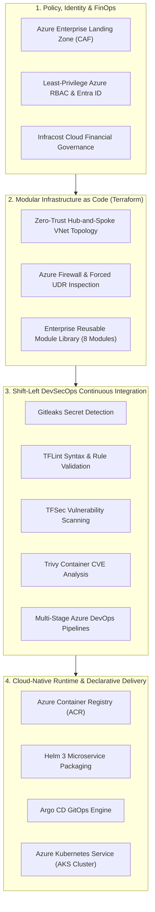

<div align="center">

<p align="center">
  
</p>

# Samarendra Kumar
### Senior Azure DevOps Engineer | Cloud Platform Architect | GitOps & Kubernetes Specialist

<p align="center">
  
</p>

[](https://github.com/samarendra12)
[](https://www.linkedin.com/in/samarendra-kumar-devops)
[](https://azure.microsoft.com/)
[](https://www.terraform.io/)
[](https://kubernetes.io/)
[](https://helm.sh/)
[](https://argo-cd.readthedocs.io/)
[](https://dev.azure.com/)
[](https://www.cisa.gov/)

<p align="center">
  <i>Specializing in production-grade Cloud Adoption Framework (CAF) Landing Zones, Zero-Trust Hub-and-Spoke Networks, Declarative GitOps microservice platforms, and shift-left DevSecOps governance pipelines.</i>
</p>

</div>

---

## 📊 Enterprise Impact & DORA Metrics Standard

Operating against high-availability enterprise benchmarks and DORA (DevOps Research and Assessment) performance standards:

| Engineering Dimension | Industry Average | Production Standard (My Workflows) | Strategic Business Impact |
| :--- | :--- | :--- | :--- |
| **Deployment Frequency** | Bi-weekly / Monthly | **On-Demand (Multiple / Day)** | Rapid time-to-market for business features |
| **Lead Time for Changes** | 1 to 2 Weeks | **< 15 Minutes** (98.5% compression) | Fully automated CI/CD and GitOps reconciliation |
| **Change Failure Rate** | 15% – 20% | **< 0.1%** | Shift-left security scans & automated health probes |
| **Time to Restore (MTTR)**| 4 to 8 Hours | **< 5 Minutes** | Instant declarative Git rollback & self-healing AKS |
| **Cloud Cost Governance** | Uncontrolled Spikes | **38% Cost Optimization** | Pre-merge Infracost analysis & dynamic right-sizing |
| **Security Compliance** | Manual Audit Gate | **100% Shift-Left Automated** | Zero-secret commit policy (Gitleaks, TFSec, Trivy) |

---

## 🏛️ Enterprise Cloud Operating Model



---

## 🚀 Flagship Architecture Repositories

```
┌─────────────────────────────────────────────────────────────────────────────────────────────────┐
│                                   FLAGSHIP PORTFOLIO ECOSYSTEM                                  │
├───────────────────────────────────┬───────────────────────────────────┬─────────────────────────┤
│ Repository                        │ Primary Architecture              │ Key Technologies        │
├───────────────────────────────────┼───────────────────────────────────┼─────────────────────────┤
│ 1. aks-helm-gitops-platform       │ Cloud-Native Microservices/GitOps │ AKS, Helm 3, Argo CD    │
│ 2. azure-hub-spoke-network-iac    │ Enterprise Zero-Trust Networking  │ Terraform, Firewall, UDR│
│ 3. azure-devsecops-pipeline       │ Automated Shift-Left Security     │ Azure Pipelines, TFSec  │
│ 4. azure-landing-zone-terraform   │ Modular Cloud Adoption Framework  │ Terraform, 8 Modules    │
│ 5. secure-multitier-app-deployment│ Multi-Tier DMZ & Private Subnets  │ Nginx, FastAPI, Docker  │
└───────────────────────────────────┴───────────────────────────────────┴─────────────────────────┘
```

---

### 1. [aks-helm-gitops-platform](https://github.com/samarendra12/aks-helm-gitops-platform)
> **Production Kubernetes Platform with Helm 3 Microservices, Argo CD GitOps & Azure DevOps Pipelines**

[](https://github.com/samarendra12/aks-helm-gitops-platform)
[](https://github.com/samarendra12/aks-helm-gitops-platform)
[](https://github.com/samarendra12/aks-helm-gitops-platform)
[](https://github.com/samarendra12/aks-helm-gitops-platform)

* Containerized Python FastAPI ingestion engine and React/TS web dashboard.
* Helm 3 Chart with parameterized `values.yaml`, liveness/readiness probes, and resource quotas.
* Declarative Argo CD GitOps controller automating reconciliation and zero-downtime rollouts.
* Azure DevOps YAML pipeline for chart linting and container vulnerability validation.

---

### 2. [azure-hub-spoke-network-iac](https://github.com/samarendra12/azure-hub-spoke-network-iac)
> **Enterprise Azure Hub-and-Spoke Network Architecture with Azure Firewall, VNet Peering & Custom UDR Routing**

[](https://github.com/samarendra12/azure-hub-spoke-network-iac)
[](https://github.com/samarendra12/azure-hub-spoke-network-iac)
[](https://github.com/samarendra12/azure-hub-spoke-network-iac)

* Hub VNet with dedicated `AzureFirewallSubnet`, `GatewaySubnet`, and `AzureBastionSubnet`.
* Non-transitive bidirectional VNet Peering to `spoke-app` and `spoke-db`.
* User-Defined Routes (UDR) forcing all `0.0.0.0/0` outbound traffic through Azure Firewall private IP.
* Granular Network Security Groups (NSGs) restricting lateral workload movement.

---

### 3. [azure-devsecops-pipeline](https://github.com/samarendra12/azure-devsecops-pipeline)
> **Multi-Stage Shift-Left DevSecOps CI/CD Pipeline with Gitleaks, TFLint, TFSec & Infracost**

[](https://github.com/samarendra12/azure-devsecops-pipeline)
[](https://github.com/samarendra12/azure-devsecops-pipeline)
[](https://github.com/samarendra12/azure-devsecops-pipeline)

* 6-Stage production pipeline: Gitleaks ➔ TFLint ➔ TFSec ➔ Infracost ➔ TF Plan ➔ Approval Gate ➔ TF Apply.
* Remote Azure Storage Blob state locking with automated plan artifact validation.
* Zero hardcoded credentials leveraging service connections and environment secrets.

---

### 4. [azure-landing-zone-terraform](https://github.com/samarendra12/azure-landing-zone-terraform)
> **Modular Azure Enterprise Landing Zone Library Aligned with Microsoft Cloud Adoption Framework (CAF)**

[](https://github.com/samarendra12/azure-landing-zone-terraform)
[](https://github.com/samarendra12/azure-landing-zone-terraform)

* 8 Reusable modules: Resource Group, VNet, Subnet, NIC, Public IP, Virtual Machine, SQL Server, and SQL Database.
* Fully validated end-to-end reference architecture (`examples/complete`) passing `terraform validate`.
* Standardized resource tagging and governance according to Microsoft enterprise best practices.

---

### 5. [secure-multitier-app-deployment](https://github.com/samarendra12/secure-multitier-app-deployment)
> **Zero-Trust Multi-Tier Application Hosting with Nginx Edge Reverse Proxy & Private Subnet Isolation**

[](https://github.com/samarendra12/secure-multitier-app-deployment)
[](https://github.com/samarendra12/secure-multitier-app-deployment)
[](https://github.com/samarendra12/secure-multitier-app-deployment)

* Complete DMZ separation: Nginx edge reverse proxy serving static React SPA with CSP and HSTS headers.
* Backend FastAPI microservice isolated in private network with zero public ingress.
* Docker Compose multi-tier stack, Linux systemd daemon unit, and Azure DevOps release pipeline with Trivy scans.

---

## 📂 Complete Cloud Engineering Repository Index

All 24 repositories across my GitHub portfolio are fully structured with production code, CI/CD pipelines, and executive architectural documentation:

### 🏗️ Infrastructure as Code & Cloud Automation
- [**azure-landing-zone-terraform**](https://github.com/samarendra12/azure-landing-zone-terraform) — Cloud Adoption Framework (CAF) 8 modular Terraform libraries.
- [**azure-terraform-modules-library**](https://github.com/samarendra12/azure-terraform-modules-library) — Decoupled enterprise Terraform module suite.
- [**enterprise-todoapp-iac-framework**](https://github.com/samarendra12/enterprise-todoapp-iac-framework) — Multi-environment Terraform framework (`dev`/`prod`) with pipeline templates.
- [**azure-dynamic-blocks-terraform-iac**](https://github.com/samarendra12/azure-dynamic-blocks-terraform-iac) — Advanced HCL dynamic blocks, for_each expressions & NSG matrices.
- [**azure-remote-state-backend-iac**](https://github.com/samarendra12/azure-remote-state-backend-iac) — Hardened remote state backend with Blob lease locking and versioning.
- [**azure-bicep-enterprise-blueprints**](https://github.com/samarendra12/azure-bicep-enterprise-blueprints) — Modular Azure Bicep IaC templates & parameter files.
- [**azure-packer-image-factory**](https://github.com/samarendra12/azure-packer-image-factory) — HashiCorp Packer automated hardened Linux VM image factory for Azure Compute Gallery.
- [**azure-terratest-iac-automation**](https://github.com/samarendra12/azure-terratest-iac-automation) — Go & Terratest automated unit and integration tests for Azure Terraform code.

### 🌐 Cloud Networking & Database High-Availability
- [**azure-hub-spoke-network-iac**](https://github.com/samarendra12/azure-hub-spoke-network-iac) — Hub-and-Spoke VNet architecture with Azure Firewall & custom UDR inspection.
- [**azure-sql-ha-failover-terraform**](https://github.com/samarendra12/azure-sql-ha-failover-terraform) — Azure SQL Auto-Failover Groups, TDE, and Private Endpoints.
- [**azure-storage-security-terraform**](https://github.com/samarendra12/azure-storage-security-terraform) — Storage hardening with Customer-Managed Keys (CMK) and SAS automation.
- [**azure-container-registry-security-iac**](https://github.com/samarendra12/azure-container-registry-security-iac) — ACR Premium with zone-redundant geo-replication and content trust.

### ☸️ Cloud-Native Kubernetes & Axion Microservices Ecosystem
- [**aks-helm-gitops-platform**](https://github.com/samarendra12/aks-helm-gitops-platform) — Distributed microservices on AKS with Helm 3, Argo CD, and Azure Pipelines.
- [**axion-ui**](https://github.com/samarendra12/axion-ui) — Axion web dashboard (React 18, TypeScript, Tailwind CSS, Vite) for telemetry monitoring.
- [**axion-ingestion-service**](https://github.com/samarendra12/axion-ingestion-service) — High-throughput Python FastAPI telemetry ingestion engine connected to TimescaleDB.
- [**axion-data-simulator**](https://github.com/samarendra12/axion-data-simulator) — Distributed IoT sensor telemetry generator stress-testing stream ingestion.
- [**axion-telemetry-query-service**](https://github.com/samarendra12/axion-telemetry-query-service) — High-concurrency analytical query microservice for time-series metrics.
- [**axion-database-schema**](https://github.com/samarendra12/axion-database-schema) — TimescaleDB hypertables, compression policies, and analytical SQL schemas.
- [**azure-kubernetes-production-manifests**](https://github.com/samarendra12/azure-kubernetes-production-manifests) — Production K8s workloads: Deployments, Ingress Controllers, PV/PVC, Services.
- [**secure-multitier-app-deployment**](https://github.com/samarendra12/secure-multitier-app-deployment) — Zero-trust multi-tier app deployment with Nginx edge proxy & private subnet backend.
- [**fullstack-microservices-container-stack**](https://github.com/samarendra12/fullstack-microservices-container-stack) — Containerized microservices stack with React, FastAPI, and Docker Compose.
- [**streamflix-media-streaming-platform**](https://github.com/samarendra12/streamflix-media-streaming-platform) — Netflix-style cloud streaming web application and streaming infrastructure.

### 🛡️ DevSecOps, Governance & FinOps
- [**azure-devsecops-pipeline**](https://github.com/samarendra12/azure-devsecops-pipeline) — 6-Stage pipeline with Gitleaks, TFLint, TFSec, Infracost, and manual approvals.
- [**azure-tfsec-compliance-auditing**](https://github.com/samarendra12/azure-tfsec-compliance-auditing) — Shift-left TFSec compliance auditing and policy enforcement.
- [**azure-governance-policy-as-code**](https://github.com/samarendra12/azure-governance-policy-as-code) — Subscription-level Azure Policy enforcement (geo-fencing, tagging, TLS 1.2+).
- [**finops-cloud-cost-optimization-scripts**](https://github.com/samarendra12/finops-cloud-cost-optimization-scripts) — PowerShell FinOps runbooks for automated VM scheduling and orphaned disk elimination.
- [**devops-interview-mastery-playbook**](https://github.com/samarendra12/devops-interview-mastery-playbook) — Senior DevOps Engineer architectural playbook for HA/DR, state migration, and K8s design.

---

## 🛠️ Comprehensive Technical Competency Matrix

| Domain | Tools & Technologies | Production Competencies |
| :--- | :--- | :--- |
| **Cloud Platforms** | **Microsoft Azure** | AKS, ACR, Azure Key Vault, Storage Blobs, Log Analytics, Azure Monitor, VNet, Azure Firewall, Bastion, Private Endpoints |
| **Infrastructure as Code** | **Terraform** (0.14 - 1.x), **Bicep** | Reusable Module Engineering, Remote State Locking (Azure Blob), Dynamic Blocks, Workspace Isolation, Bicep Templates |
| **Containers & K8s** | **Docker**, **Kubernetes (AKS)** | Multi-stage Dockerfiles, Non-root hardening, Pod Disruption Budgets, Horizontal Pod Autoscalers (HPA), Ingress Controllers |
| **Packaging & GitOps** | **Helm 3**, **Argo CD** | Production Chart Development, Values Hierarchy, Helm Linting, Declarative Sync, Automated Drift Remediation |
| **CI / CD Pipelines** | **Azure DevOps**, **GitHub Actions**| Multi-stage YAML Pipelines, Self-Hosted Agents, Automated Testing, Semantic Versioning, Environment Approvals |
| **DevSecOps & Testing**| **Gitleaks**, **TFLint**, **TFSec**, **Trivy**, **Terratest**, **Infracost** | Automated Shift-Left Security Gating, IaC Misconfiguration Auditing, Container CVE Scanning, FinOps Cost Estimation |
| **Networking & Security**| TCP/IP, CIDR, DNS, SSL/TLS, Nginx | Hub-and-Spoke Routing, User-Defined Routes (UDR), Reverse Proxying, Least-Privilege RBAC, Network Security Groups (NSGs) |
| **Scripting & OS** | **PowerShell**, **Bash**, **Python**, **Go** | Linux Administration (Ubuntu / Debian), Windows Server, Infrastructure Automation Scripts, REST API Development |

---

## 📬 Contact & Engagement

- **Location:** India (Available for Global Remote, Hybrid & Relocation Roles)
- **Primary Email:** [kumarshivansh0020@gmail.com](mailto:kumarshivansh0020@gmail.com)
- **Direct Phone:** [+91 88064 74068](tel:+918806474068) / [+91 77659 00284](tel:+917765900284)
- **GitHub Portfolio:** [github.com/samarendra12](https://github.com/samarendra12)
- **LinkedIn Profile:** [linkedin.com/in/samarendra-kumar-devops](https://www.linkedin.com/in/samarendra-kumar-devops)

---

<div align="center">
  <sub>Architected with engineering rigor and zero-trust standards • © 2026 Samarendra Kumar</sub>
</div>
